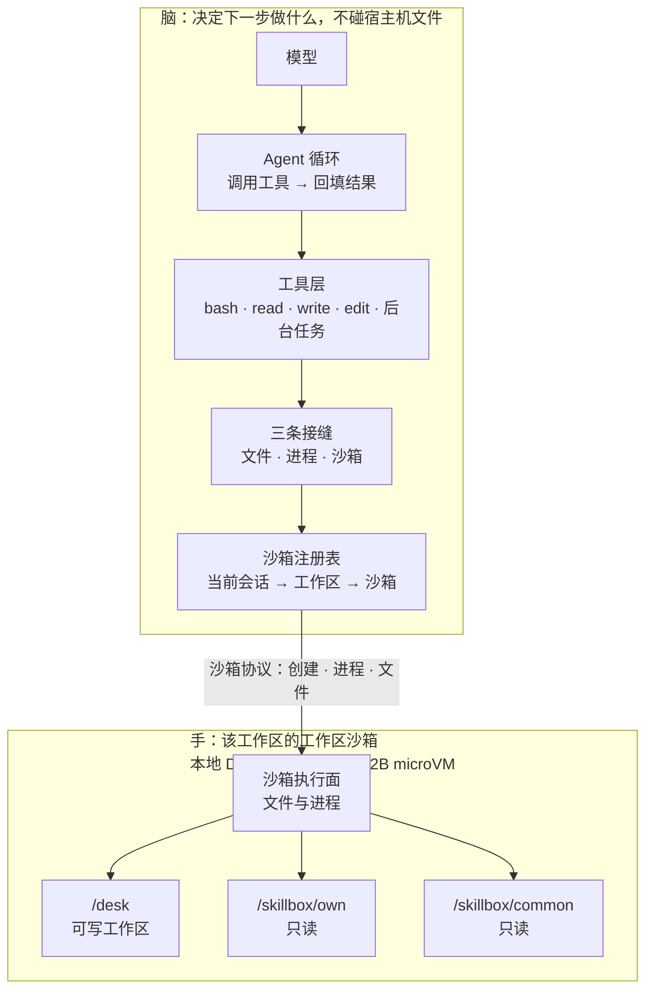
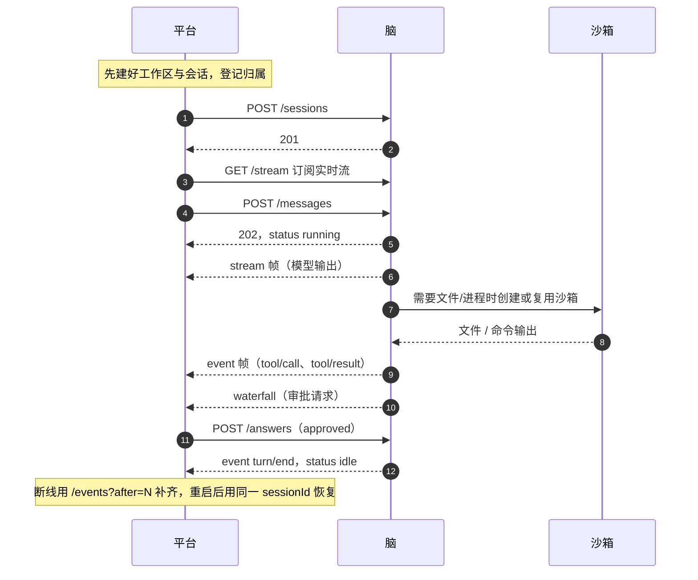

# 沙箱脑（dsh-sandbox-brain）

一份可水平扩展的 Agent 运行时。模型在这里推理；文件读写和命令执行不在脑进程里，而是进入当前会话所属工作区的沙箱（本地 Docker 容器 / 部署 E2B microVM）。脑不认识租户，用户和归属由调用方声明、由共享数据库判定。

- 运行时：Node.js 24.9+；本地默认 SQLite，部署用 PostgreSQL 16
- 内核：锁定 `@deepseek-ai/dsh@0.2.2-rc.3`

## 设计思路

**手脑分离。** 脑只决定下一步做什么；读文件、跑命令都进沙箱，不直接碰脑进程的文件系统。

**租户在脑之外。** 脑进程没有账号体系。谁在调用、会话属于谁、工作区在哪，由调用方在请求里声明，并由共享数据库里的目录表判定。

**会话写在数据库里。** 每一轮都写入会话日志；另一台脑可以接上同一条会话继续，历史不依赖某一台副本是否还在。

**沙箱按工作区隔离。** 一个工作区一台按需创建的沙箱、一份持久存储（部署时是共享 OSS 前缀，或显式配置的 E2B 卷）；同一工作区的多个会话共享同一批文件。

用起来四步：建立或恢复会话、订阅会话实时流、提交一轮消息、在同一个流上答复审批/提问。模型地址和密钥随创建请求传入，只存在于该会话的内存中。

完整方案与取舍见 [技术方案](./docs/技术方案.md)；沙箱在阿里云上的形态见 [阿里云沙箱](./docs/阿里云沙箱.md)。

## 架构



模型在脑里想，工具调用穿过文件、进程、沙箱三条接缝，按当前会话找到工作区，命令和文件都落在对应工作区的沙箱里。脑进程没有挂载工作区的磁盘，部署时工作区文件由共享 OSS 保管，换一台脑也可以按需重新挂载；本地 `storage.dir` 是单机目录，换机器就看不到文件。

## 对外 API

全部能力都在 `/brain/v1` 一个 HTTP 面上：JSON 请求 + SSE 事件流。没有 WebSocket，也没有 Upgrade 路由；字段、请求体和错误码见 [接口文档](./docs/接口.md)，新增路由必须先写进文档再实现。

按用途分六类：

- **会话生命周期**：新建或恢复会话、从日志分叉、中断当前轮次。
- **消息与实时流**：提交消息（排队或插话），用 SSE 订阅会话事件、状态和流式输出，答复审批/提问/计划评审，按 `seq` 补历史。
- **会话内操作**：投影基线、切模型、斜杠命令、目标、预设、反馈。
- **后台任务**：任务清单、增量输出、终止。
- **工作区文件**：列目录、读写内容、文件元信息。
- **目录**：模型、预设、权限预设。

认证走请求头：`x-app-id` / `x-app-key` 标识调用方，`x-dsh-user-id` 声明代表哪个用户，涉及工作区时带 `x-dsh-workspace-id`。创建或恢复会话还要带模型地址和密钥（`x-dsh-model-base-url` / `x-dsh-model-key`），密钥只留在该会话的内存里。

会话列表、搜索、统计、工作区 CRUD、输入队列的产品界面、附件、文件搜索和 watch 都不在脑里，由平台负责；脑只接受 `queue` / `steer` 两种入队语义。脑只提供给定 `sessionId` 的原子动作和事实，不存成员、工作区这类业务数据。

## 一次完整使用流程

下面的流程覆盖创建会话、发消息、执行工具、响应审批和结束回合；调用方通常是平台。



- `stream` 的 `event` 帧只实时、不回放；断线后用 `GET /events?after=N` 按 `seq` 补齐。
- 审批、提问、计划评审共用一条通道：下行是 `waterfall` 帧，上行是 `POST /answers`。
- 沙箱懒创建：会话可以先纯对话，第一次需要文件或进程时才建沙箱。

## 部署启动

本地需要 Node.js 24.9+：`config.yaml` 不写数据库时，就和平台共用一个 SQLite 文件，不用安装数据库。本地沙箱默认用 Docker（按需为每个工作区起一个容器），需要可用的 Docker daemon；不可用时回退 mock（没有安全隔离）。部署和多副本在配置里加 `database.url` 换成 PostgreSQL 16，并配好 `aliyun.oss`（与平台同一套）；多副本的脑必须放在按 `x-dsh-workspace-id` 做一致性哈希的路由层后面，同一工作区的请求落到同一台脑，否则写租约、沙箱绑定和待答请求会在副本之间漂移。

脑跑在平台后面，通常按平台仓库的「部署启动」先起平台，再把这里起起来。`dev.sh` 把进程放后台，命令返回后服务已经在跑，关掉终端不影响。

```bash
# 1. 先起平台，然后把平台 config.yaml 里的 credentialsKey、brain.appId / brain.appKey
#    填到本仓库 config.yaml 的 credentialsKey、platform.appId / platform.appKey（两边必须一致）

# 2. 本仓库：装依赖并启动，监听 8080
npm install
./scripts/dev.sh

# 3. 查看和停止
./scripts/dev.sh status
./scripts/dev.sh stop
```

日志在 `var/log/brain.log`。两边默认指向同一个 SQLite 文件 `../dsh-sandbox-platform/var/dsh.sqlite`；用 PostgreSQL 时 `database.url` 指向同一地址。

## 配置

唯一配置在 `config.yaml`，字段旁有注释。数据库不写就和平台共用本地 SQLite（默认 `../dsh-sandbox-platform/var/dsh.sqlite`）；写 `database.url` 接 PostgreSQL，写 `database.file` 换 SQLite 文件位置。

`platform.appKey` 和 `credentialsKey` 留空时启动脚本会自己生成，但不会和平台对齐；把它们改成平台 `config.yaml` 里对应的值。`platform.appId` 默认 `platform`，要和平台的 `brain.appId` 一致。`appId` / `appKey` 不一致会在鉴权层被拒；`credentialsKey` 不一致要等到解密 MCP 请求头时才失败。

模型密钥不写进配置，创建会话时由请求头传入，只存在于该会话的内存里。

## 沙箱模式

| 模式 | 条件 | 文件落在哪 |
|---|---|---|
| `docker` | `aliyun.sandbox.apiKey` 为空且本机 Docker daemon 可用 | 按需为每个工作区起一个容器；只挂当前工作区和只读技能前缀，文件落回 `storage.dir` |
| `mock` | `aliyun.sandbox.apiKey` 为空且 Docker 不可用（或 `SANDBOX_ADAPTER=mock`） | `storage.dir` 下的本地目录，工作区映射为 `desks/{workspaceId}` → `/desk` |
| `e2b` | `aliyun.sandbox.apiKey` 非空 | 阿里云 E2B microVM；默认直接挂平台预置的 OSS 前缀（工作区 `desks/{workspaceId}` + 两块只读技能前缀）；把 profile 里的 `ossMounts` 整段去掉时才退回预建卷，卷由部署方自行准备 |

本地适配器可用 `SANDBOX_ADAPTER=docker|mock` 显式指定；显式要 `docker` 但 daemon
不可用会直接启动失败。容器镜像默认 `node:22-bookworm-slim`（`DSH_DOCKER_IMAGE`），
默认不出网（`DSH_DOCKER_NETWORK=none`），默认以宿主 `uid:gid` 运行
（`DSH_DOCKER_USER` 可覆盖；宿主是 root 时应指定非 root）。

Docker 模式有容器内核边界（非 root、收 capability、只读 rootfs、只挂工作区前缀），
但本地 `storage.dir` 仍是所有租户共用的一棵宿主树，只适合单用户开发。mock 只用于
本地兜底，不是 OSS / E2B 的模拟器，也没有安全隔离。

## 测试

三条命令各管一件事，都在本仓库目录下跑，不需要先把平台或脑启动起来：

```bash
npm run typecheck    # 类型检查
npm run test:unit    # 单元测试，不依赖外部数据库服务
npm run test:e2e     # 端到端测试，默认用临时 SQLite
```

- **`npm run typecheck`**：只做类型检查（`tsc --noEmit`），不执行测试。改完代码先跑它，类型写错会直接报出来。
- **`npm run test:unit`**：跑 `test/unit`，不依赖外部服务的纯逻辑测试——鉴权头、HTTP 解析、MockPlatform 与 Docker 适配器（内存 CLI）、归属判定、定时规则、会话目录、技能挂载、SQLite 翻译等。不连外部数据库服务；部分用例会建临时 SQLite，随时可跑。
- **`npm run test:e2e`**：跑 `test/integration` 和 `test/e2e`。默认给每个测试文件建一个临时 SQLite 文件，覆盖鉴权、会话创建/消息/取消/事件流、归属判定和技能注入的完整流程；跑完自动删除。
- `npm test` 等于一次跑完所有测试（不含 typecheck）。
- 要回归 PostgreSQL 方言，加 `TEST_DB=postgres`：会自动拉起临时 PostgreSQL（端口 55432，用户 `dsh`，数据目录 `.test-pgdata`），跑完停库，不碰开发用的数据库。
- 本机没装 PostgreSQL 16 时，PG 模式会自动改用仓库内 `.test-pg-bin` 下的预编译二进制；也可以用 `TEST_PG_PORT`、`TEST_PG_USER`、`TEST_PG_DATA`、`TEST_PG_BIN` 换测试库的端口、用户、数据目录和二进制路径。

## 已知边界

- 沙箱进程的编号在脑内存里，脑重启后旧编号失效；交互式终端不在范围内
- 沙箱创建发生在第一次需要文件或进程时，会话可以先对话
- 脑不跑清扫定时器：E2B 沙箱按创建时写入的 TTL 结束，本地 Docker 容器不会自动回收，需要删会话/工作区或手动清理
- 一轮被打断后不会自动重跑；目标也不会无人值守地一轮接一轮继续
